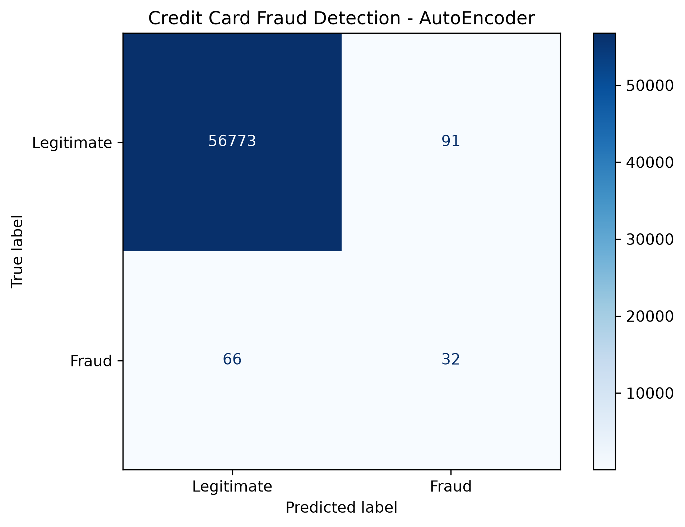

# Credit Card Fraud Detection Using PyOD AutoEncoder

## Project Overview

This project implements a credit card fraud detection system using
the PyOD AutoEncoder deep learning algorithm.

The AutoEncoder learns patterns from legitimate transactions and
identifies potentially fraudulent transactions based on
reconstruction errors.

## Dataset

Source: https://www.kaggle.com/datasets/whenamancodes/fraud-detection

- Total transactions: 284,807
- Legitimate transactions: 284,315
- Fraudulent transactions: 492
- Input features: 30
- Missing values: 0

The dataset is highly imbalanced, with fraud accounting for
approximately 0.17% of all transactions.

## Technologies Used

- Python
- PyOD
- PyTorch
- Pandas
- NumPy
- Scikit-learn
- Matplotlib

## Methodology

1. Load and explore the credit card dataset.
2. Split the dataset into training (80%) and testing (20%).
3. Train using only legitimate transactions.
4. Standardize features using StandardScaler.
5. Train the PyOD AutoEncoder for 10 epochs.
6. Predict anomalies in the test dataset.
7. Evaluate performance using precision, recall, F1-score,
   confusion matrix, and ROC-AUC.

## Experiment Results

| Metric           | Result        |
| ---------------- | ------------- |
| Training samples | 227,451       |
| Testing samples  | 56,962        |
| Training epochs  | 10            |
| Training time    | 39.03 seconds |
| Fraud precision  | 0.26          |
| Fraud recall     | 0.33          |
| Fraud F1-score   | 0.29          |
| ROC-AUC          | 0.9542        |

### Confusion Matrix

|                   | Predicted Legitimate | Predicted Fraud |
| ----------------- | -------------------: | --------------: |
| Actual Legitimate |               56,773 |              91 |
| Actual Fraud      |                   66 |              32 |

## How to Run

1. Clone this repository.
2. Create and activate a Python virtual environment.
3. Install dependencies:

   pip install -r requirements.txt

4. Download the dataset from Kaggle.
5. Place creditcard.csv inside the data folder.
6. Run:

   python fraud_detection.py

## Conclusion

The AutoEncoder achieved a ROC-AUC score of 0.9542,
demonstrating its ability to distinguish anomalous transactions.

However, the model detected only 32 of the 98 fraudulent
transactions in the test dataset at the selected threshold.

Further improvements could include threshold optimization,
hyperparameter tuning, and additional evaluation techniques.

## References

PyOD: https://github.com/yzhao062/pyod

Dataset: https://www.kaggle.com/datasets/whenamancodes/fraud-detection
